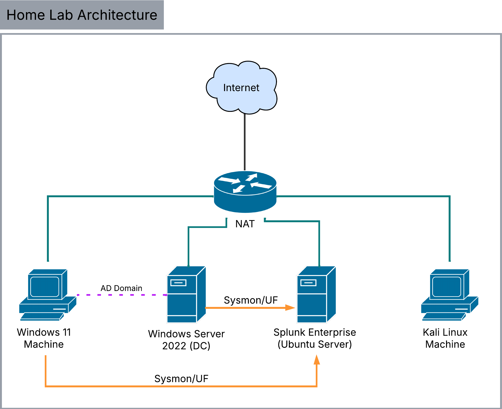
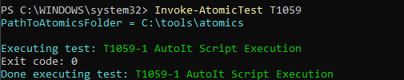
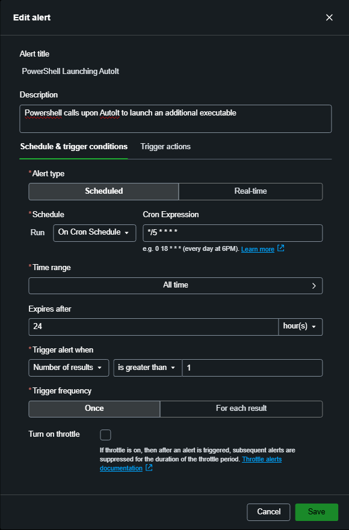
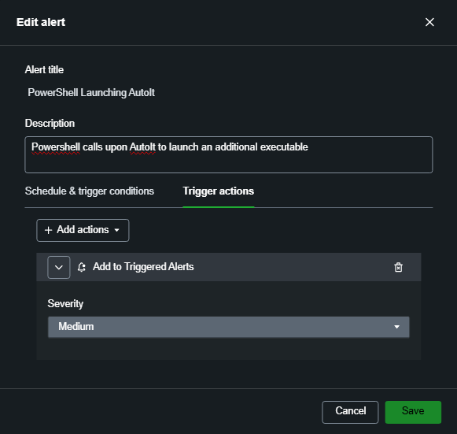
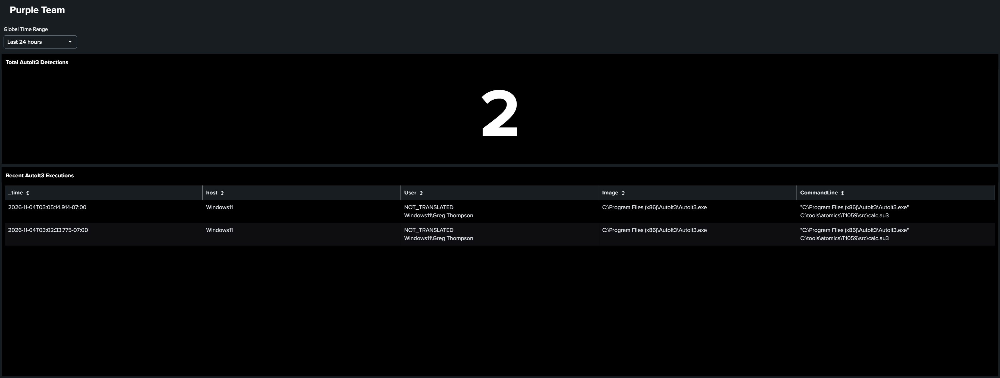
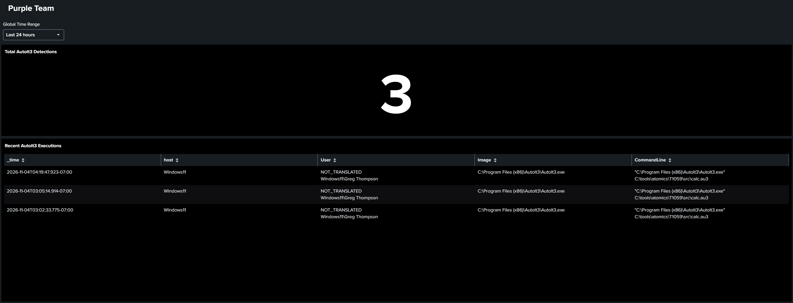

# T1059.010: AutoIt Script Execution

**Tactic:** Execution
**Technique:** [T1059.010, Command and Scripting Interpreter: AutoHotKey & AutoIT](https://attack.mitre.org/techniques/T1059/010/)
**Result:** Attack executed successfully, detected in Splunk, alert + dashboard created

## Summary

I used Atomic Red Team to run an AutoIt script on a domain-joined Windows 11 endpoint, found the resulting process-creation event (Sysmon Event ID 1) in Splunk, and built a scheduled alert that fires whenever AutoIt executes. Alerts feed a dashboard for quick triage.

AutoIt is a legitimate scripting tool that attackers also use to run payloads and evade simple detections, which makes it a useful technique to practice detecting.

## Lab environment

The diagram below shows the environment used for this attack.

<p align="left">
  
</p>

| Component | Role |
|---|---|
| Windows 11 (domain-joined) | Attack target, where the atomic test was run |
| Windows Server 2022 | Domain controller |
| Splunk Enterprise | SIEM, receives logs via forwarder |
| Sysmon | Endpoint telemetry (process creation, etc.) |

## Preparation

1. Created a restore point on the Windows 11 VM before running anything.
2. Allowed scripts in PowerShell with `Set-ExecutionPolicy RemoteSigned`.
3. Installed Invoke-AtomicRedTeam.
4. Reviewed the test with `Invoke-AtomicTest T1059-1 -ShowDetails` before running it.

## Attack

**Run from:** Windows 11 client, elevated PowerShell

```powershell
Invoke-AtomicTest T1059-1
```

**Time executed:** < 1 minute

<p align="left">
  
</p>

## Issue encountered: Splunk couldn't read Sysmon logs

Sysmon events weren't showing up in Splunk at first. The forwarder's service account lacked permission to read the Sysmon event data. I fixed it by running the Splunk service as the Local System account.

> **Tradeoff:** Local System is a high-privilege account, which is acceptable in an isolated lab but not best practice in production. A tighter option would be giving a dedicated service account read access to the event log channel (for example via the Event Log Readers group.)

## Evidence in Splunk

Searching for Sysmon Event ID 1 (process creation) around the time of the test revealed the AutoIt executable launching.

**Key fields:**

| Field | Value |
|---|---|
| EventCode | 1 |
| Image | C:\Program Files (x86)\AutoIt3\AutoIt3.exe |
| CommandLine | "C:\Program Files (x86)\AutoIt3\AutoIt3.exe" C:\tools\atomics\T1059\src\calc.au3 |
| ParentImage | C:\Windows\System32\WindowsPowerShell\v1.0\powershell.exe |
| User | Windows11\Greg Thompson |

## Detection

```spl
host=Windows11 EventCode=1
Image="*AutoIt3.exe"
```

Saved as a Splunk alert:

- **Schedule:** runs every 5 minutes
- **Trigger:** one or more matching events
- **Action:** add to Triggered Alerts with a severity of Medium

<p align="left">
  
</p>
<p align="left">
  
</p>

The query is also saved in [`detection.spl`](detection.spl).

## Dashboard

Splunk dashboard showing recent AutoIt executions and detection timeline

<p align="left">
  
</p>

## Validation

I re-ran the test and confirmed the search returned a new event, the scheduled alert triggered successfully, and the dashboard reflected the amount of alerts present.

<p align="left">
  
</p>

## Limitations and false positives

- **Legitimate use:** AutoIt is used by IT staff and some software for automation, so this alert would be noisy in an environment that uses it. Tuning could exclude known-good parent processes, users, or script paths.
- **Easy to evade:** matching on the filename means an attacker can rename the executable. Matching on the Sysmon `OriginalFileName` field, file hashes, or suspicious command-line patterns (such as `.au3` files run from temp directories) would be sturdier.
- **Scope:** this rule only covers one host and the process-creation event.

## Cleanup

```powershell
Invoke-AtomicTest T1059.010 -Cleanup
```

## Next steps

* Improve the detection by validating and using Sysmon's OriginalFileName field to detect renamed copies of AutoIt3.exe.
* Perform a detection-evasion test by renaming AutoIt3.exe and comparing the original rule against the improved rule.
* Expand the dashboard to include additional ATT&CK techniques and detection trends.

## References

- [MITRE ATT&CK T1059.010](https://attack.mitre.org/techniques/T1059/010/)
- [Atomic Red Team: T1059.010](https://github.com/redcanaryco/atomic-red-team/tree/master/atomics/T1059.010)
